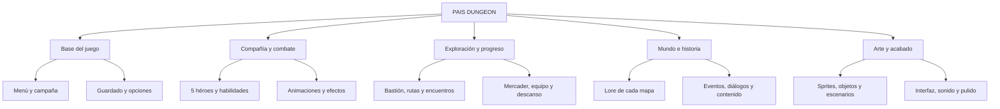

# PAIS DUNGEON — mapa de proyecto y planificación

> Documento vivo para saber qué está construido, qué está en desarrollo y qué queda por hacer.  
> Estado revisado: **Build 039**.

## Visión del proyecto

**PAIS DUNGEON** es un RPG táctico de fantasía oscura protagonizado por cinco héroes. La aventura gira alrededor de una tierra maldita, el Bastión del Último Farol y las decisiones que toma la compañía mientras avanza por distintas rutas, combate, consigue equipo y se prepara para continuar.

El objetivo es convertir la base jugable actual en una aventura completa: con identidad visual consistente, mapas diferenciados, historia y lore propio, más contenido y una experiencia pulida de principio a fin.

## Mapa general

## Estado actual — lo que ya está hecho

### 1. Base del juego
- [x] Menú principal con Nueva partida, Continuar, Opciones y Créditos.
- [x] Estructura de campaña con navegación por secciones.
- [x] Interfaz principal con recursos de compañía: oro, vida y raciones.
- [x] Identidad visual de fantasía oscura y diseño adaptable a distintas pantallas.

### 2. Compañía y personajes
- [x] Cinco protagonistas: **Salim, Pol, Igor, Ivan y Alex**.
- [x] Fichas de héroe y retratos.
- [x] Estructura de carpetas para animaciones individuales por personaje.
- [x] Animaciones idle y secuencias de combate conectadas para los héroes que ya tienen sus sprites preparados.
- [x] Normalización del tamaño, línea de suelo y ritmo de las animaciones para evitar saltos entre reposo y ataque.

### 3. Combate y habilidades
- [x] Sistema de combate por turnos y presentación de acciones.
- [x] Ataques, habilidades especiales, curaciones, escudos y efectos de estado.
- [x] Efectos visuales de magia y golpes.
- [x] Ajustes de tiempos para coordinar preparación, impacto y recuperación.
- [x] Corrección de cálculos de daño y curación en habilidades concretas.

### 4. Progresión, equipo y economía
- [x] Mercado con puestos y Gachapón.
- [x] Monedas, precios, rarezas y probabilidades de obtención.
- [x] Colección e inventario de objetos.
- [x] Equipamiento individual por héroe y ranuras de equipo.
- [x] Estadísticas de personaje afectadas por el equipo.
- [x] Persistencia local de la colección y migración de partidas anteriores.

### 5. Bastión, rutas y descanso
- [x] Bastión como centro de la campaña.
- [x] Sección de rutas con tres recorridos definidos en la interfaz.
- [x] Encuentros y estructura inicial de exploración.
- [x] Sistema de descanso: consume una ración y recupera un 25% de vida y maná máximos de los cinco héroes.
- [x] Contador de descansos disponibles, botón principal de descanso y acceso al mercado cuando faltan raciones.
- [x] Fondo de descanso personalizable por el jugador, guardado localmente en el navegador, con ilustración predeterminada del campamento.

### 6. Arte y animación ya incorporados
- [x] Retratos de los cinco protagonistas.
- [x] Sprites PNG transparentes y animaciones por frames para los personajes preparados.
- [x] Escenario ilustrado para la zona de descanso y recursos gráficos de hoguera/campamento.
- [x] Ajustes de encuadre y escala para escritorio y móvil.

## Hoja de ruta — lo que queda por hacer

Las tareas están ordenadas por dependencias y prioridad orientativa. Las casillas se marcarán cuando estén implementadas y comprobadas dentro del juego.

### Fase 1 — Cerrar y mejorar la zona de descanso
- [ ] Definir el diseño definitivo de la zona de descanso y su ambientación.
- [ ] Mejorar la integración del fondo personalizado con los paneles y controles.
- [ ] Añadir objetos y pequeños detalles ambientales que den vida al campamento.
- [ ] Incorporar animaciones ambientales opcionales y configurables, sin perjudicar el rendimiento.
- [ ] Revisar estados visuales: sin raciones, descanso disponible, recuperación y confirmaciones.
- [ ] Comprobar el comportamiento en escritorio, tablet y móvil.

### Fase 2 — Gran mejora gráfica
- [ ] Sustituir elementos provisionales por arte pixel-art definitivo.
- [ ] Crear y revisar objetos del mundo: cofres, puertas, barriles, señales, vegetación, ruinas y decoraciones.
- [ ] Completar las animaciones que falten para los cinco héroes.
- [ ] Mejorar animaciones de enemigos, ataques, impactos, habilidades y estados.
- [ ] Diseñar enemigos con siluetas y animaciones reconocibles.
- [ ] Unificar paletas, iluminación, escalas, contornos y perspectiva entre todas las pantallas.
- [ ] Revisar recortes, transparencias, tamaños y alineación de cada sprite.

### Fase 3 — Mapas, exploración y lore
- [ ] Diseñar cada mapa como una localización con identidad visual propia.
- [ ] Crear una pantalla o introducción narrativa al llegar por primera vez a cada mapa.
- [ ] Explicar el lore, el contexto, los peligros y los personajes importantes de cada zona.
- [ ] Añadir textos de ambientación, señales, documentos, diálogos y secretos.
- [ ] Dar más variedad a los encuentros y eventos de cada ruta.
- [ ] Conectar la historia de los mapas con la maldición y el viaje de los cinco protagonistas.

### Fase 4 — Más contenido y profundidad jugable
- [ ] Ampliar la cantidad y variedad de enemigos y jefes.
- [ ] Añadir nuevos encuentros, eventos y decisiones durante las rutas.
- [ ] Ampliar las habilidades y progresión de los héroes.
- [ ] Añadir más armas, armaduras, accesorios, consumibles y objetos especiales.
- [ ] Equilibrar economía, precios, recompensas, rarezas y dificultad.
- [ ] Añadir recompensas y objetivos únicos por mapa.
- [ ] Dar más utilidad y personalidad a las visitas al Bastión y al Mercader.

### Fase 5 — Historia y campaña completa
- [ ] Definir el argumento principal de principio a fin.
- [ ] Desarrollar la historia personal de Salim, Pol, Igor, Ivan y Alex.
- [ ] Añadir diálogos y escenas entre personajes.
- [ ] Crear introducciones y cierres para los capítulos o mapas.
- [ ] Diseñar jefes ligados a la historia y a cada región.
- [ ] Dar continuidad narrativa a las consecuencias de avanzar por la campaña.

### Fase 6 — Pulido, pruebas y lanzamiento
- [ ] Revisar todas las pantallas, menús, ventanas y transiciones.
- [ ] Corregir errores de lógica, interfaz, guardado y progresión.
- [ ] Comprobar que las partidas antiguas siguen funcionando tras las actualizaciones.
- [ ] Optimizar carga de imágenes, animaciones y rendimiento.
- [ ] Revisar accesibilidad, legibilidad y opción de reducir movimiento.
- [ ] Probar la experiencia completa en escritorio y móvil.
- [ ] Unificar textos, nombres, iconos, sonidos y feedback de acciones.
- [ ] Preparar una versión estable y una descripción clara del juego.

## Criterios para marcar una tarea como terminada

Una tarea no se considera completada solo porque exista el archivo o el diseño. Debe estar integrada en el juego, funcionar correctamente, verse bien en los tamaños de pantalla previstos y no romper sistemas ya existentes.

## Registro de versiones

El historial detallado de cambios y builds se mantiene en el [README principal](README.md). Este documento se centra en el estado global y en los siguientes objetivos del proyecto.

---

**Prioridad general:** terminar de consolidar las pantallas actuales, elevar la calidad gráfica, dar identidad e historia a cada mapa, ampliar el contenido y finalmente dedicar una fase completa a pruebas y pulido.

